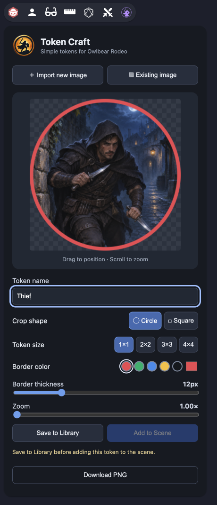
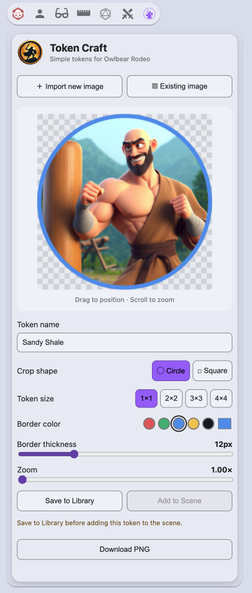

<p align="center">
  
</p>

<h1 align="center">Token Craft</h1>

<p align="center">Create custom character tokens without leaving Owlbear Rodeo.</p>

<p align="center">
  
</p>

<p align="center">
  <a href="#installation">Install</a> ·
  <a href="#how-to-use">How to Use</a> ·
  <a href="https://github.com/jakeis0dd/token-craft/issues">Support &amp; Feedback</a>
</p>

## Overview

Token Craft is an Owlbear Rodeo extension for turning your artwork into custom character tokens. Import an image or choose one from your Characters library, adjust its crop and border, then save the finished token for your games. Create and place tokens inside your room, or download a 512×512 PNG to keep a local copy.

## Features

- **Circle and square crops** for character portraits and other artwork.
- **Drag to position and scroll to zoom**, with a zoom slider for finer adjustments.
- **Border options** with adjustable thickness, preset colors, a custom color picker, and **No Border** for a full crop without an outline.
- **Four token sizes:** 1×1, 2×2, 3×3, and 4×4 grid squares.
- **Save to Library** to store your finished token in Owlbear Rodeo's Characters library.
- **Add to Scene** to select your saved token and place it near the center of your view.
- **Grid alignment** with centered image origins and size-aware placement on square grids.
- **Responsive height requests** based on Owlbear's viewport, with native popover constraints and a 430px requested width.
- **Native light/dark themes** that follow Owlbear Rodeo and update automatically while the extension is open.
- **PNG download** for saving the finished artwork outside Owlbear Rodeo.

## Screenshots

<table align="center">
  <tr>
    <td align="center"></td>
    <td align="center"></td>
  </tr>
</table>

<p align="center"><em>The Token Craft editor in Owlbear Rodeo's dark and light themes.</em></p>

## Installation

Install Token Craft as a custom extension using this manifest URL:

```text
https://jakeis0dd.github.io/token-craft/manifest.json
```

1. Sign in to [Owlbear Rodeo](https://www.owlbear.rodeo/) and open your profile.
2. Choose **Add Extension**, paste the manifest URL above, and complete the installation.
3. Enable Token Craft when creating a room. For an existing room, open its extension menu and add Token Craft.
4. Open your room and click the **Token Craft** warrior icon in the extension bar.

You can also [open the manifest](https://jakeis0dd.github.io/token-craft/manifest.json) or follow Owlbear Rodeo's [extension installation guide](https://extensions.owlbear.rodeo/guide).

## How to Use

1. **Choose your artwork.** Click **Import new image** to upload a file, or **Existing image** to choose an image from your Characters library.
2. **Frame the token.** Choose a circle or square crop. Drag the image to position it, then scroll over the preview or use the **Zoom** slider to adjust the framing.
3. **Customize the finish.** Give the token a name, select a size from **1×1** through **4×4**, and choose your border color and thickness. Select the checkerboard-and-slash **No Border** swatch to remove the outline; choosing a color again restores your stored thickness.
4. **Save your token.** Click **Save to Library** and wait for the upload to complete. Your token is saved as a Character asset.
5. **Place it in your game.** With a scene open, click **Add to Scene** and select the token you just saved in Owlbear Rodeo's image picker. You can also drag the saved token from Characters onto the scene.

Changing the artwork or any token setting requires another **Save to Library** before **Add to Scene** is available. Selecting the saved token in the picker is part of the placement workflow; the upload does not automatically select it for you. Folder selection and picker behavior are handled by Owlbear Rodeo.

Use **Download PNG** whenever you want a local copy. The [standalone editor](https://jakeis0dd.github.io/token-craft/) supports PNG export; library access and scene placement require opening the extension inside an Owlbear Rodeo room.

### Grid alignment

Tokens use a centered image origin and retain their selected footprint on the square grid. **Add to Scene** snaps 1×1 and 3×3 token centers to cell centers, and 2×2 and 4×4 token centers to intersections, so their outer edges follow grid lines.

Existing library assets and scene items are not automatically updated. Re-save older tokens to apply the corrected library origin.

### Appearance

Token Craft follows Owlbear Rodeo's light/dark setting automatically, with no separate theme toggle. Theme changes update the interface without resetting edits or changing your artwork, border-color selection, or exported PNG colors. The editor-only transparency checkerboard uses neutral light grays in light mode and retains its dark pattern in dark mode. Light mode adds a subtly raised main surface, a thin border, and soft layered shadows inside Token Craft's own frame. The gold logo's existing transparency blends into either theme. The standalone editor uses dark mode.

## Support and Feedback

Found a bug or have an idea? [Open an issue](https://github.com/jakeis0dd/token-craft/issues) to report a problem, request a feature, or share feedback.

For bug reports, include your browser, token size, steps to reproduce the problem, and a screenshot if useful.

## Development

Token Craft uses **Vite, React, TypeScript, and the Owlbear Rodeo SDK**. With Node.js and npm installed, clone or download this repository, open a terminal in its folder, and run:

```bash
npm install
npm run dev
```

The local editor is available at `http://localhost:5173/token-craft/`. To test library and scene actions, install `http://localhost:5173/token-craft/manifest.json` as a custom extension and enable it in a room. Keep the development server running while testing.

Build and preview the production extension:

```bash
npm run build
npm run preview
```

The build checks TypeScript and writes production files to `dist/`. The preview is available at `http://localhost:4173/token-craft/`.

The `/token-craft/` base path is shared by Vite and the manifest's icon and popover URLs. The gold [`public/logo.png`](public/logo.png) is used for the application header and extension management card; [`public/toolbar-icon.svg`](public/toolbar-icon.svg) remains the separate toolbar icon. The existing [GitHub Pages workflow](.github/workflows/deploy.yml) builds and deploys `dist/` when changes are pushed to `main`; local build and preview commands do not publish changes.

### Test locally

Version 0.6.0's No Border feature has passed live testing in Owlbear Rodeo. Native theme synchronization from v0.5.0 and responsive popover height from v0.4.0 were previously verified by the developer in live rooms. Use the localhost manifest above for further local testing without changing the published extension.

The extension requests the height returned by [`OBR.viewport.getHeight()`](https://docs.owlbear.rodeo/extensions/apis/viewport/#getheight) through [`OBR.action.setHeight()`](https://docs.owlbear.rodeo/extensions/apis/action/#setheight). It updates on opening and checks for host height changes every 750 ms while open. Unchanged heights do not trigger another resize, SDK requests are serialized, and polling stops on close or application cleanup. The manifest retains 430px width and a 780px initial/fallback height. The v0.4.0 height controller, normal document scrolling, and 320px crop preview are unchanged.

Theme initialization uses [`OBR.theme.getTheme()` and `OBR.theme.onChange()`](https://docs.owlbear.rodeo/extensions/apis/theme/), with newer events taking precedence over a delayed initial response. CSS variables share one layout across both modes; light mode uses Owlbear's supplied palette. The mounted editor stays briefly invisible against a transparent surface while initializing, then appears when a theme arrives or falls back to dark mode after 1.5 seconds, including if SDK readiness stalls. Later theme events can still recover from the fallback. Browser form controls use the selected `color-scheme`; native color-picker dialogs can vary by browser and operating system.

Owlbear controls the final rendered dimensions and placement. The SDK does not expose the bottom toolbar's bounds or an available-height measurement for action popovers, so exact clearance above the toolbar and ellipsis button cannot be guaranteed. No parent DOM access or guessed toolbar offsets are used. If viewport height requests do not produce the desired layout, record the result for review rather than adding an offset workaround.

1. Start `npm run dev`, install `http://localhost:5173/token-craft/manifest.json` as a separate custom extension, and enable that local extension in a test room. Disable the published copy in that room to avoid confusing the two.
2. **Short window:** Open Token Craft in a short browser window. Check that controls remain reachable with a single vertical scrollbar when needed, the preview keeps its size, and the bottom toolbar and ellipsis remain accessible.
3. **Tall window:** Increase the browser height with Token Craft still open. Allow about one second for the next check; verify that the panel requests more space beyond the old 780px limit even when content already fits. Check for unnecessary scrollbars and note the actual gap above Owlbear's bottom controls.
4. **Resize and reopen:** Alternate between short and tall windows, then close the extension, resize the browser, and reopen it. Check that height updates resume, width stays approximately 430px where space permits, and the panel does not oscillate or repeatedly resize while the browser is stationary.
5. **Token controls:** Import artwork, drag and wheel-zoom over the preview, and confirm wheel zoom does not scroll the panel. Test circle/square crops, border controls, PNG download, and Save to Library followed by Add to Scene for sizes 1×1 through 4×4; verify grid and condition-marker alignment.
6. **Fallback:** Also open the standalone local editor to check PNG export without Owlbear, and try the extension in a room with no scene open. If an SDK height request fails, the current/native fallback size is retained and a warning appears in the browser console.
7. **Live theme changes:** With artwork loaded and unsaved changes, switch Owlbear between light and dark. Check that the interface updates immediately, the chosen border color and token settings stay intact, and the save/placement workflow is unaffected. Compare PNG exports before and after switching; the token artwork and colors should match. Check selected controls, status text, disabled buttons, keyboard focus, and the native color picker in each mode.
8. **Opening and layout:** Close and reopen the extension in each theme, checking for incorrect-theme flashes or a lingering blank surface. Repeat theme changes in both short and tall browser windows, verifying scrolling, preview size, wheel zoom, and responsive height. Review the light-mode surface border and shadows, readable empty-preview text on each checkerboard, and the logo's transparent exterior. Owlbear owns the outer popover frame and may clip shadows at the iframe boundary.

Run the theme and height-controller tests with the existing development dependencies:

```bash
node --test tests/*.test.mjs
```

These tests cover No Border crop coverage, remembered thickness, saved-token invalidation, all four token sizes, initial and live themes, initialization races, subscription cleanup, safe fallback, button-text contrast, resize requests, unchanged heights, delayed SDK calls, and failure recovery with mocked APIs and timers. Native host behavior, first-paint appearance, browser controls, scrolling, and wheel interactions also require live-room testing.

<details>
<summary>Release history and validation</summary>

- **v0.6.0:** Replaces the black border preset with a theme-aware checkerboard-and-slash **No Border** option. Circle and square crops fill their full footprint without a stroke or invisible inset in previews and exported PNGs. Border thickness and color are remembered when switching back to a colored border, and custom black remains available through the color picker. Changing No Border requires re-saving before Add to Scene. Includes 14 new regression tests covering both crop shapes, thickness restoration, save-state tracking, and all four token sizes. The No Border feature passed live testing in Owlbear Rodeo.
- **v0.5.0:** Adds automatic native Owlbear light/dark themes with semantic CSS variables, live SDK subscriptions, initialization race protection, a bounded dark fallback, and visible keyboard focus indicators. Preserves dark styling closely while improving enabled-button text contrast. Light mode adds subtle panel elevation and a lighter editor-only checkerboard; the header logo uses its existing transparency without a dark CSS backdrop. The extension management card uses the gold logo while retaining the separate toolbar icon. Token data, rendering, source artwork, and the responsive-height controller are unchanged. Native theme synchronization was live-tested, and the visual refinements were reviewed for release.
- **v0.4.0:** Adds responsive action-height requests using documented Owlbear SDK APIs. Polls the host viewport every 750 ms only while open, skips redundant resizes, and serializes pending requests. Retains the existing styling, token workflow, and v0.3.3 grid-alignment correction. The developer verified correct responsive sizing in a live Owlbear Rodeo room with both short and tall browser windows.
- **v0.3.3:** Corrects token grid alignment in Save to Library and Add to Scene. Both paths use the image center as the snapping and rotation origin: `(256, 256)` for the exported 512×512 image. DPI remains `512 / gridSize`, preserving all four footprints. Scene placement converts the screen center to scene coordinates before snapping; other grid types use the SDK's corner and center targets. Crop, zoom, borders, artwork, and PNG export are unchanged.
- **Validation:** The v0.3.3 production build passed. A one-off regression harness exercised the application handlers and installed SDK builders with mocked Owlbear APIs; all 36 combinations of four token sizes, three scene DPIs (70/150/300), and three pan/zoom configurations passed. Live-room testing of the v0.3.3 correction remains pending, including library dragging, rotation, and condition-marker alignment.
- **v0.3.2:** Refined the toolbar icon with a thinner ring and inset silhouette. The developer previously verified image import and selection, drag positioning, wheel zoom, crop shapes, border controls, all four token sizes, Save to Library, and Add to Scene inside Owlbear Rodeo.
- **v0.3.1:** Updated branding with a white silhouette toolbar icon and a centered gold logo with a transparent background.

For SDK details, see Owlbear Rodeo's [image builder reference](https://docs.owlbear.rodeo/extensions/reference/builders/image/), [grid snapping API](https://docs.owlbear.rodeo/extensions/apis/scene/grid/#snapposition), and [image alignment explanation](https://blog.owlbear.rodeo/effortless-map-alignment/).

</details>

## Credits

Built for [Owlbear Rodeo](https://www.owlbear.rodeo/) using the [Owlbear Rodeo SDK](https://github.com/owlbear-rodeo/sdk). Thank you to the Owlbear Rodeo team for providing the platform and extension tools.

Token Craft is an independent community extension.
